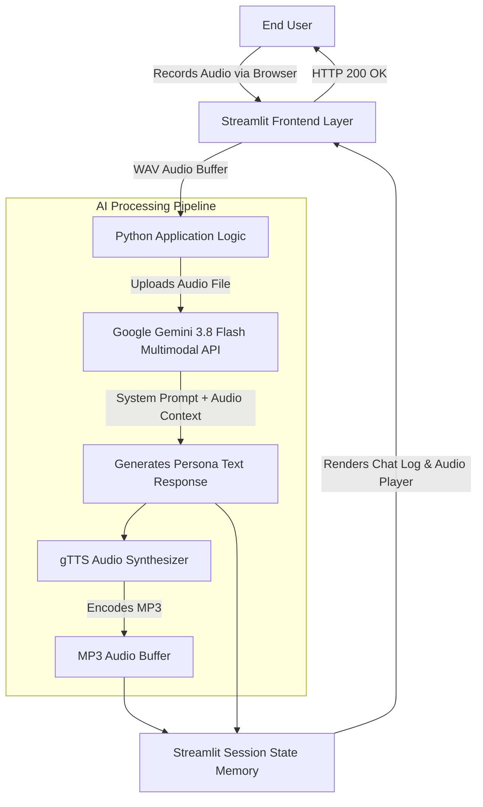

# Interview-bot

**🔴 Live Demo:** [**Access the Live End-to-End Voice Agent Here**](https://interview-bot-9aavefzzwai3vmfzjwzhv7.streamlit.app/)
*(Runs natively in-browser. Grants microphone telemetry access to initiate inference loop).*

## Technical Abstract & Motivation

Deploying interactive, low-latency AI agents requires efficient orchestration of Large Language Models (LLMs) and Text-to-Speech (TTS) pipelines. 

This repository implements a production-ready, interactive AI voice clone built to serve as an interactive portfolio. Designed with a serverless architecture, it processes live microphone audio, generates contextual persona-driven responses using Google's native multimodal LLMs, and synthesizes conversational audio playback—all within a seamless, zero-setup web interface. It acts as an automated virtual agent capable of answering questions about my background, technical skills, and engineering mindset.

---

## System Architecture Diagram


## Technology Stack

* **Frontend / State Management:** [Streamlit](https://streamlit.io/) (Custom CSS Glassmorphism UI, Session State for chat history)

* **LLM / STT Engine:** [Google GenAI SDK](https://ai.google.dev/) (`gemini-3.8-flash` for native multimodal audio transcription and inference)

* **Text-to-Speech (TTS):** [gTTS](https://gtts.readthedocs.io/en/latest/) (Google Text-to-Speech API)

* **Deployment & Hosting:** Streamlit Community Cloud (CI/CD connected to GitHub `main` branch)

## Core Engineering Features

1. **Multimodal Audio Processing:** Bypasses traditional transcription bottlenecks by feeding raw `.wav` audio directly into Gemini 3.8 Flash, utilizing its native multimodal capabilities for faster inference.

2. **Dynamic Session State:** Implements persistent `st.session_state` to maintain chat history, allowing users to scroll through past interactions and replay generated audio seamlessly without page resets.

3. **Prompt Engineering & Persona Injection:** Utilizes a highly constrained System Prompt to enforce a first-person perspective, specific biographical facts, and strict output formatting (e.g., stripping timestamp hallucinations to ensure clean TTS generation).

4. **Zero-Setup UX:** Designed specifically for non-technical users. Features live status updates (`st.status`), browser-native microphone access, and responsive dark-mode styling—requiring no API keys or local installations from the end user.

## Local Installation & Setup

If you wish to run this application locally:

1. **Clone the repository:**

   ```
   git clone https://github.com/joysa2002/interview-bot.git
   cd interview-bot
   
   ```

2. **Install dependencies:**

   ```
   pip install -r requirements.txt
   
   ```

3. **Set your Environment Variables:**
   Create a `.streamlit/secrets.toml` file in the root directory and add your Google AI API Key:

   ```
   GEMINI_API_KEY = "Your-API-Key-Here"
   
   ```

4. **Launch the application:**

   ```
   streamlit run app.py
   
   ```

*Developed by Joysa Anthony D Silva L*
